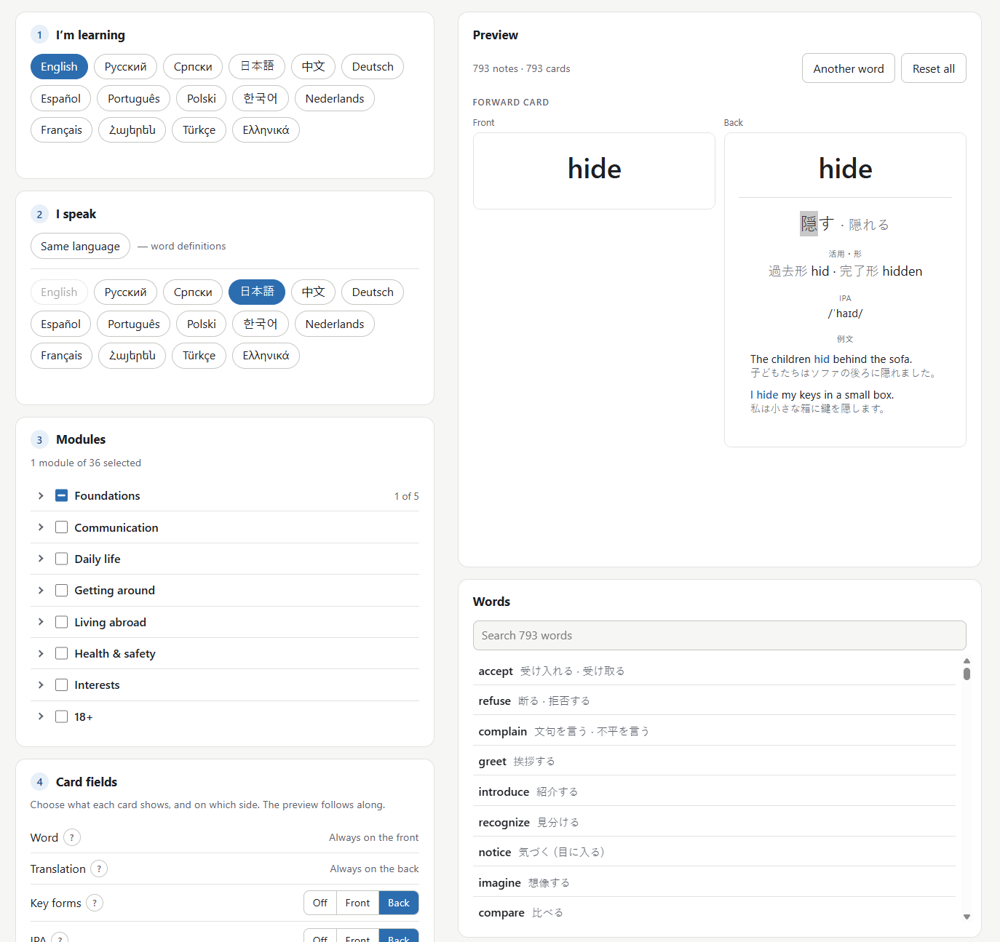

# AnkiGen Flow

A fork of [AnkiGen](https://github.com/xenohunter/ankigen) by Phil Filippak that adds **flow drills** after Idahosa Ness's Mimic Method to the decks it builds: the ear and the mouth before the page. Step 6 on the page turns them on, each one adding cards to the deck AnkiGen would have built:

- **Speak the word:** the word, article included, read by Anki's text-to-speech on forward fronts and reverse backs.
- **Ear cards:** hear the word (and see its IPA) before you ever see it spelled; say it back, then flip.
- **Shadow cards:** the example sentence at quarter, half or three-quarter speed and then at full speed, with no text; the sentence waits on the back.
- **Reflex cards:** a noun asks for its article, a verb for a key form, inside a bar that drains in a moment and a half.
- **Drill cues:** whisper it, pause, hold someone warm in mind, hum the melody first, stand up.
- **Speak as:** the ego switch; name the native speaker whose voice you borrow.

No media files: the cards carry `{{tts}}` tags, which Anki desktop, AnkiDroid and AnkiMobile read with the voices installed on the device. With every drill off, the deck is AnkiGen's, under the fork's own deck and note-type names. The drills, their fields and templates, and what is deliberately not here are in [`docs/FLOW.md`](docs/FLOW.md). Everything below is AnkiGen's README, which still describes the vocabulary, the page and the tooling.

---

# AnkiGen

[](https://www.patreon.com/cw/blisstweeting)
[](https://buymeacoffee.com/blisstweeting)

Free Anki vocabulary decks in 15 languages, built in your browser: **https://xenohunter.github.io/ankigen/**



Pick the language you're learning and one you speak (or same-language definitions), choose topic modules and card fields, and download an `.apkg` for Anki or AnkiDroid. Nothing is uploaded. Decks are deterministic: a newer download imports over the old deck and keeps your review history.

Languages: English, Russian, Serbian, Japanese, Chinese, German, Spanish, Portuguese, Polish, Korean, Dutch, French, Armenian, Turkish and Greek. Next: Italian, Irish, Scottish Gaelic and Swedish.

The vocabulary is drafted by an AI model and partly reviewed by people. Spotted an error? Select it on a card and press Ctrl+Enter, or use the Feedback button.

## Development

No build step, no dependencies; Node 22 for tooling.

```
python3 -m http.server 8000   # open http://localhost:8000/ (add ?data=tests/fixtures/data for the small test set)
npm test                      # unit tests
npm run lint:data             # validate data/ (lint:fixtures: the golden sample)
node tools/bundle.mjs         # build the site into _site/, with the landing pages under decks/
```

Downloading needs `https://` or `localhost`. Every push to `master` deploys to GitHub Pages (`.github/workflows/pages.yml`); to release a data update, bump `data` in `data/meta/version.json`. Design, data format and generation are documented in [`docs/`](docs/).

## License

Code: [MIT](LICENSE). Vocabulary in `data/`: [CC BY-SA 4.0](data/LICENSE.md). `vendor/`: see [`vendor/README.md`](vendor/README.md).
